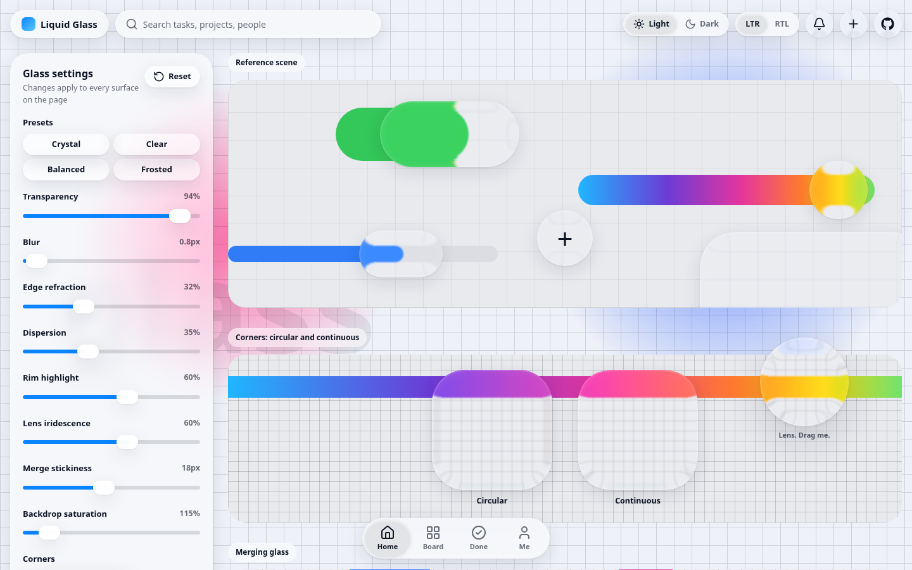
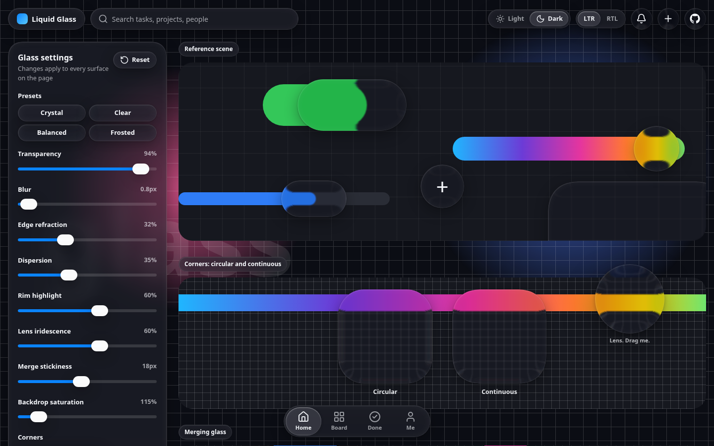

# liquid-glass-components

Liquid glass UI components for React. Real edge refraction, a light source that follows the pointer, spring physics, and glass that merges like drops of liquid.

[](https://github.com/alimohammad0816/liquid-glass-components/actions/workflows/ci.yml)
[](LICENSE)


**[Live demo](https://alimohammad0816.github.io/liquid-glass-components/)**

<p align="center">
  
  
</p>

## Why this exists

Most "glass" UI is a blurred translucent rectangle. The material that glass actually looks like comes from three things that a blur does not give you:

- **Refraction at the rim.** Glass is flat in the middle and bends light only where the surface curves. Here the edge of every surface shows the content behind it folded over, inverted and compressed, like a thick convex lens.
- **Light with a direction.** A highlight travels along the rim of every surface towards the pointer, with a weaker reflection on the opposite side.
- **Motion with mass.** Surfaces are moved by springs. They stretch along their velocity, settle with a small wobble, and fuse into one shape when they get close to each other.

This library packages those effects as accessible React components and a single stylesheet, with no runtime dependency besides React and [`motion`](https://motion.dev).

## Features

- Edge refraction with chromatic dispersion, built from an SVG displacement map computed for the exact geometry of each surface
- Continuous (squircle) corners via `corner-shape: superellipse()`, with a circular fallback
- Shared light source with a pointer driven rim highlight, written as CSS variables so moving the light never renders React
- Spring based motion: press feedback, liquid stretch along the direction of travel, jelly lens, morphing menu
- `GlassMerge`: surfaces that fuse into one blob when they approach each other, using a signed distance field and marching squares
- Light, dark and automatic color schemes, driven by CSS custom properties
- Right to left layouts, using logical CSS properties and direction aware keyboard handling
- Keyboard and screen reader support: a native range input under the slider, radio group semantics on the segmented control, a focus trapping dialog, a live region for toasts
- Reduced motion support: springs jump to their target and the moving light is disabled
- Written in TypeScript, with types included; no CSS in JS

## Browser support

The effect degrades gracefully. Everything below is detected at runtime.

| Capability                                        | Chromium (Chrome, Edge, Brave, Opera, Arc) | Safari            | Firefox           |
| ------------------------------------------------- | ------------------------------------------ | ----------------- | ----------------- |
| Blur, tint, rim, light, motion, merging           | Yes                                        | Yes               | Yes               |
| Edge refraction (SVG filter in `backdrop-filter`) | Yes                                        | No                | No                |
| Continuous corners (`corner-shape`)               | Chromium 139+                              | Circular fallback | Circular fallback |

SVG filters inside `backdrop-filter` are only implemented by Chromium. In other browsers surfaces render as blurred glass with the rim highlight, which still looks good but lacks the refraction. This is a limitation of the platform, not a setting.

## Installation

```bash
npm install liquid-glass-components motion
```

`react`, `react-dom` and `motion` are peer dependencies. React 18 or newer is required.

## Quick start

Import the stylesheet once, and wrap the part of the page that contains glass in a `GlassProvider`.

```tsx
import { useState } from "react";
import { GlassProvider, GlassButton, GlassCard, GlassSwitch } from "liquid-glass-components";
import "liquid-glass-components/styles.css";

export function App() {
  const [enabled, setEnabled] = useState(true);

  return (
    <GlassProvider mode="auto">
      <GlassCard title="Notifications" subtitle="Choose what you hear about">
        <GlassSwitch label="Email digest" checked={enabled} onChange={setEnabled} />
        <GlassButton variant="tinted">Save</GlassButton>
      </GlassCard>
    </GlassProvider>
  );
}
```

Glass needs something to refract. Place it over content with color, imagery or fine detail; over a flat color it looks like a plain translucent panel.

### Next.js and other React Server Component frameworks

The package ships with the `"use client"` directive, so the components can be imported from server components. Import the stylesheet in your root layout.

## Components

| Component                        | Description                                                                            |
| -------------------------------- | -------------------------------------------------------------------------------------- |
| `GlassProvider`                  | Root of a glass tree. Supplies settings, color scheme and direction.                   |
| `LiquidGlass`                    | The surface everything else is built on. Use it to make your own glass elements.       |
| `GlassButton`, `GlassIconButton` | Buttons. `variant="tinted"` renders the glass in the accent color for primary actions. |
| `GlassSegmented`                 | Segmented control and tab bar. The selection lens can be dragged.                      |
| `GlassSwitch`                    | Switch with a knob that becomes a glass lens under a finger.                           |
| `GlassSlider`                    | Slider on top of a native range input.                                                 |
| `GlassInput`                     | Text input in a glass capsule.                                                         |
| `GlassChip`, `GlassCard`         | Label and card surfaces.                                                               |
| `GlassMenu`                      | A button that opens into its own menu.                                                 |
| `GlassDialog`, `GlassToast`      | Modal dialog and notification.                                                         |
| `GlassMerge`, `GlassMergeItem`   | A group of items drawn as one fused piece of glass.                                    |

### Building your own surface

`LiquidGlass` renders a `motion` element, so every animation prop of `motion` works on it.

```tsx
import { LiquidGlass } from "liquid-glass-components";

<LiquidGlass
  as="button"
  radius="pill"
  interactive
  whileTap={{ scale: 1.08 }}
  style={{ width: 120, height: 48 }}
>
  Open
</LiquidGlass>;
```

| Prop          | Default           | Description                                                   |
| ------------- | ----------------- | ------------------------------------------------------------- |
| `as`          | `"div"`           | Element to render.                                            |
| `radius`      | `24`              | Corner radius in pixels, or `"pill"` for a capsule.           |
| `bezel`       | derived from size | Width of the refracting band along the edge, in pixels.       |
| `strength`    | `1`               | Multiplier for the refraction set on the provider.            |
| `magnify`     | `false`           | Lens mode: stronger refraction for small surfaces.            |
| `interactive` | `false`           | Pointer cursor.                                               |
| `tint`        |                   | Surface color replacing the default tint. Any CSS color.      |
| `elevation`   | `1`               | `0` has no drop shadow, `2` is for dialogs and menus.         |
| `blur`        | from settings     | Backdrop blur in pixels.                                      |
| `lit`         | `true`            | Whether the shared light falls on this surface.               |
| `material`    | `"clear"`         | `"regular"` is a denser variant for surfaces that carry text. |
| `iridescent`  |                   | `0` to `1`. Rainbow rim, used for lenses under a finger.      |
| `corners`     | from settings     | `"continuous"` or `"circular"`.                               |

### Merging glass

Items inside `GlassMerge` do not draw glass. The group draws one shared layer behind them whose shape is the soft union of the items. When two items get close, a neck grows between them and they fuse like two drops; when they separate the neck stretches and snaps.

```tsx
<GlassMerge smoothing={18}>
  <GlassMergeItem as="button" bleed={6} aria-label="Edit" style={{ width: 44, height: 44 }}>
    <EditIcon />
  </GlassMergeItem>
  <GlassMergeItem as="button" bleed={6} aria-label="Share" style={{ width: 44, height: 44 }}>
    <ShareIcon />
  </GlassMergeItem>
</GlassMerge>
```

`bleed` widens an item's shape on both sides so adjacent items form one continuous capsule instead of a row of circles. Items can be moved with `motion` springs or transforms; the shape follows. Rotation and diagonal stretching are not reflected in the merged outline.

## Settings

Settings are passed to `GlassProvider`, either as a `preset` or as individual overrides.

```tsx
<GlassProvider preset="clear" settings={{ blur: 6, refraction: 80 }} accent="#7c5cff">
  {children}
</GlassProvider>
```

| Setting           | Default        | Description                                                                                                                                   |
| ----------------- | -------------- | --------------------------------------------------------------------------------------------------------------------------------------------- |
| `transparency`    | `94`           | `0` is a dense tint, `100` is nearly clear.                                                                                                   |
| `blur`            | `0.8`          | Backdrop blur in pixels. This is a standard deviation: 3 px already spreads about 12 px.                                                      |
| `refraction`      | `32`           | Edge refraction strength, 0 to 100. `0` removes the SVG filter.                                                                               |
| `chroma`          | `35`           | Chromatic dispersion of the refraction, 0 to 100.                                                                                             |
| `specular`        | `60`           | Intensity of the rim highlight, 0 to 100.                                                                                                     |
| `saturation`      | `115`          | Backdrop saturation in percent.                                                                                                               |
| `iridescence`     | `60`           | Intensity of the rainbow rim on lenses under a finger.                                                                                        |
| `mergeSmoothing`  | `18`           | Distance in pixels at which `GlassMerge` items start to fuse.                                                                                 |
| `corners`         | `"continuous"` | `"continuous"` or `"circular"`.                                                                                                               |
| `dynamicLight`    | `true`         | The rim highlight follows the pointer. When off, a uniform rim remains.                                                                       |
| `regularMaterial` | `true`         | Surfaces with `material="regular"` (cards, menus, dialogs, inputs) get a denser tint and extra blur, so text stays legible over busy content. |

Presets: `crystal` (default), `clear`, `balanced`, `frosted`. The `GLASS_PRESETS` and `GLASS_DEFAULTS` constants are exported.

### Reading settings

```tsx
const { mode, dir, transparency } = useGlassSettings();
```

`mode` is the resolved color scheme (`"light"` or `"dark"`) and `dir` is the text direction.

## Theming

Colors are CSS custom properties defined on `.lg-root`, so they can be overridden from outside.

```css
.my-app .lg-root {
  --lg-accent: #7c5cff;
  --lg-success: #1fa971;
}
```

| Variable                      | Purpose                                                     |
| ----------------------------- | ----------------------------------------------------------- |
| `--lg-accent`                 | Tinted buttons and slider fill.                             |
| `--lg-on-accent`              | Text color on the accent.                                   |
| `--lg-success`, `--lg-danger` | Switch track, toast icon, destructive menu items.           |
| `--lg-text`, `--lg-text-2`    | Primary and secondary text (derived from the color scheme). |

Use `className` and `style` on any component to adjust size, spacing and layout. Class names follow a `lg-` prefix, such as `lg-surface`, `lg-button` and `lg-segmented`.

## Right to left

Pass `dir="rtl"` to `GlassProvider`, or let it read the direction from the document. Layout uses logical properties, arrow keys on the segmented control are reversed, and the knob of the switch travels in the correct direction.

## Performance

Each surface with refraction owns one small SVG filter and one cached displacement map (at most 320 px on the long side), shared between equally sized surfaces. Dispersion, which runs the displacement three times, is skipped automatically when the color fringe would be smaller than half a pixel. The shared light only writes CSS variables, so pointer movement does not trigger React renders. `GlassMerge` updates outside React and only while something moves; it stops its animation loop after eight idle frames.

Things that are expensive regardless of this library: large `backdrop-filter` areas on weak GPUs, and many overlapping glass surfaces. If you need dozens of surfaces on screen, pass `strength={0}` to the small ones to skip their refraction, or set `refraction` to `0` on the provider.

Glass inside glass is rendered without the SVG refraction filter. Chromium turns a nested surface gray when an SVG filter sits inside another `backdrop-filter`, so nested surfaces keep the blur, tint, rim and motion but not the refraction.

## Accessibility

- Every interactive component renders a native element (`button`, `input`) or an element with the appropriate role
- `GlassIconButton` requires a `label`
- `GlassSegmented` is a radio group with arrow key, Home and End navigation
- `GlassSwitch` has `role="switch"` and works with Space and Enter
- `GlassDialog` moves focus into the dialog, traps it, closes on Escape and restores focus
- `GlassToast` is a polite live region
- Visible focus rings on all controls
- `prefers-reduced-motion` is respected

Glass reduces contrast by design. Check text contrast against the real content behind your surfaces, and prefer `material="regular"` for anything that carries paragraphs of text.

## Development

```bash
npm install
npm run dev          # demo at http://localhost:5173
npm run typecheck
npm run lint
npm test
npm run build        # library into dist/
npm run build:demo   # demo into demo-dist/
```

The demo accepts query parameters to share a configuration: `?mode=dark&dir=rtl&bg=board`.

## How it works

1. **Displacement map.** For a surface of a given size and corner radius, a canvas is filled with a vector field: neutral in the interior, and inside a band along the edge a vector pointing outwards whose length grows with the square of the depth. The red and green channels hold the vector and the blue channel holds its intensity.
2. **Filter.** The map is fed to `feDisplacementMap` inside an SVG filter, applied with `backdrop-filter: url(#id)`. Three displacements with slightly different scales, one per color channel, give the dispersion.
3. **Corners.** The map uses the same superellipse geometry as `corner-shape`, so refraction follows the corner exactly.
4. **Light.** A single listener computes, for every surface, where the pointer is in local coordinates and how close it is, and writes CSS variables. The rim is a masked gradient that reads those variables.
5. **Merging.** The union of the item shapes is a signed distance field combined with a smooth minimum. The zero iso-line, extracted with marching squares, becomes a `clip-path`; the same field produces the refraction map.

## Credits and disclaimer

The visual language is inspired by the Liquid Glass material introduced with iOS 26. This project is an independent implementation for the web and is not affiliated with or endorsed by Apple.

## License

[MIT](LICENSE)
